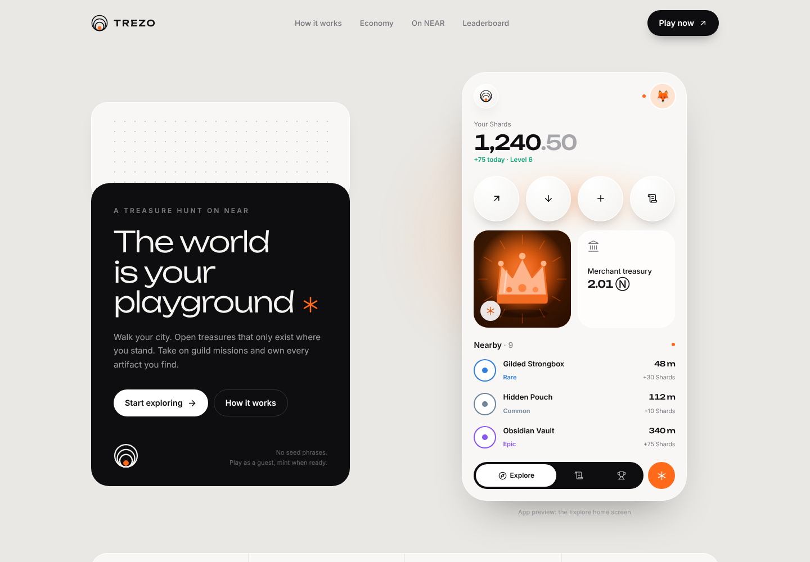
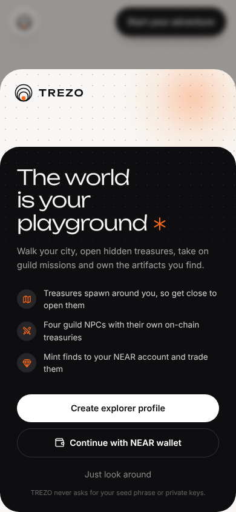
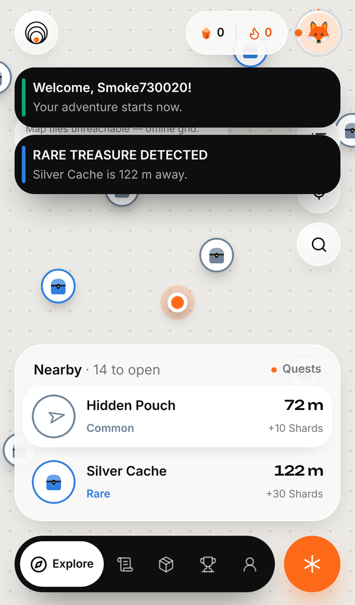
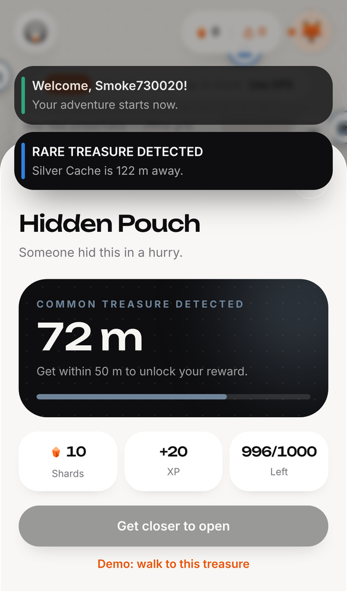
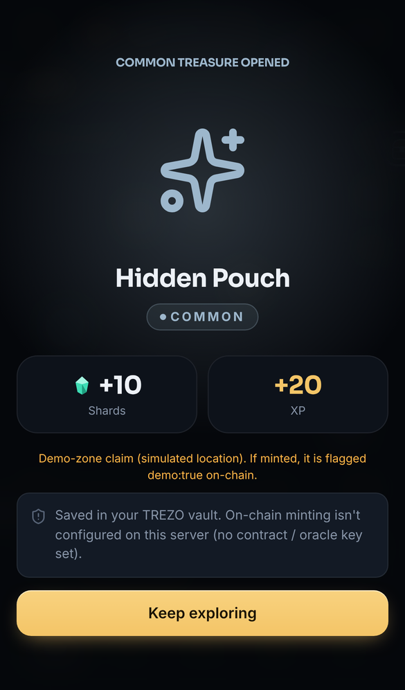
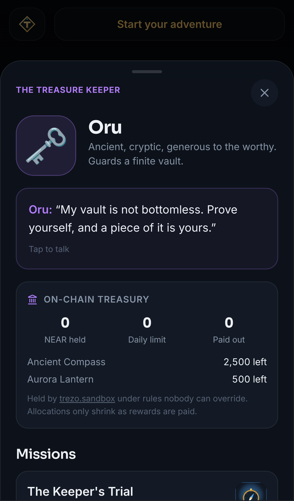
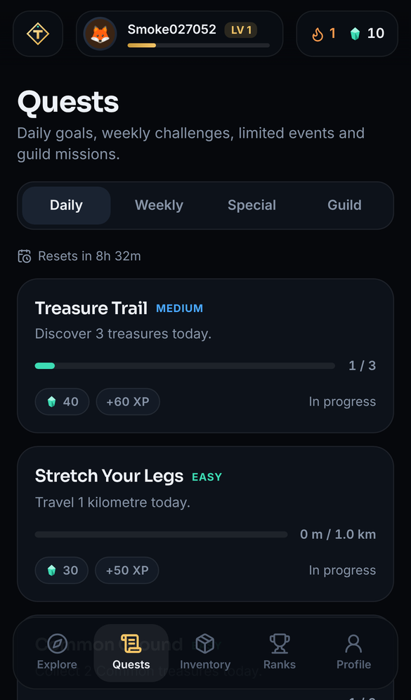

# TREZO

**The world is your playground.**

TREZO is a location-based treasure-hunting game built on **NEAR Protocol**. Players walk their city and open treasures that spawn around them. They also complete missions for four guild NPCs, collect artifacts, and trade them on a player-owned market. Each NPC runs its own rule-bound **on-chain treasury**.

Built for the **NEAR Hackathon, November 2026, Track 09: Games With Real Economies**. It covers NPCs with wallets, player-owned markets, an economy that adjusts without developer intervention, and NEP-245.



| Onboarding | Explore (demo zone) | Treasure in range | Opening | Guild NPC + live on-chain treasury | Quests |
|---|---|---|---|---|---|
|  |  |  |  |  |  |

<sub>Screenshots come from automated test runs of a local server configured against the live testnet contract (the Merchant treasury panel shows real testnet state). The test container blocked map-tile hosts, so the map shows TREZO's built-in dot-grid fallback. With normal internet access, a light OpenStreetMap-based map (OpenFreeMap / CARTO Positron) renders underneath.</sub>

**Design.** A light "daylight expedition" system: a warm paper canvas, porcelain cards with large radii, ink-black primary surfaces and a single ember-orange accent. Headlines and numbers use the wide geometric Unbounded face; body text is Inter. Navigation is a floating ink dock with a white active pill, plus an orange **Hunt** button that jumps straight to the nearest treasure. The concentric-ring logo is a compass seen from above, or a radar ping. Design tokens are in `src/app/globals.css`.

## Live on NEAR testnet

**Play it:** https://trezo-production-0500.up.railway.app (hosted on Railway, settling on testnet; E2E smoke test passes 14/14 against it)

| | |
|---|---|
| **Contract** | [`trezo-v2-f8ff97.testnet`](https://testnet.nearblocks.io/address/trezo-v2-f8ff97.testnet) (deployed 2026-11-08 after the [security review](SECURITY_REVIEW.md), near-sdk 5.30 wasm, SHA-256 `c22d6793…74485`, **economy locked**) |
| Deploy + init | [`9k1QRNGo…`](https://testnet.nearblocks.io/txns/9k1QRNGopudL7gsux7TUXASZmgCByTdhfBWjXH58fzbv), then 13 item types, 4 NPCs, 10 NPC offers, 0.5 NEAR Merchant seed and `lock_economy` ([all 8 txs](deployments/testnet.json)) |
| Economy locked (irreversible) | [`GrDm7dDB…`](https://testnet.nearblocks.io/txns/GrDm7dDBBdJ8PVvLoFPvwCegndob3zw6eL7KdX4WirM) |
| Claim → mint (NEP-245, oracle ticket) | [`3PKSyWGz…`](https://testnet.nearblocks.io/txns/3PKSyWGzEpwSRDFXY3DCC9NeRF3yzRoULn2Aj1zEghTx) |
| Storage deposit (player prepays state) | [`ELhyVvRn…`](https://testnet.nearblocks.io/txns/ELhyVvRnAjqgYPd7ZoaExSEJN6q3gbsmG8aPcuNxCeT) |
| Player listing (escrow) | [`Gr3LUs5y…`](https://testnet.nearblocks.io/txns/Gr3LUs5yhWsXdJiHymg5CYUTTrRKgvanweWdrkooBVRd) |
| Player purchase (pay seller + fee to Merchant + deliver) | [`2HFppHfm…`](https://testnet.nearblocks.io/txns/2HFppHfmCv6EKXqnhQWHEWmwKFydunwFdvm2wSM5o61a) |
| Merchant NPC sale (price 0.01 → 0.0108 NEAR) | [`FvHyyX5d…`](https://testnet.nearblocks.io/txns/FvHyyX5dv9j4vSdgNPDZKrjRZJdmXp1gsUXVR3qYwCyJ) |
| Merchant NPC buyback (paid from its treasury) | [`9ayGPSmn…`](https://testnet.nearblocks.io/txns/9ayGPSmnWoEVhZh9Ch66ZKUo2BVqp4nV7aTNrytTrPLh) |

These come from `scripts/testnet-demo.mjs` ([record](deployments/testnet-demo.json)): two faucet-funded players (`trezo-alice-2bb9d7.testnet`, `trezo-bob-ef6a55.testnet`) signing with their own keys, against the real game server. The claim was made in the demo zone, so its on-chain record says `demo: true`. The pre-review contract `trezo-game-0e8b06.testnet` (2026-11-07) is retired; its records are kept in `deployments/testnet-v1*.json`.

---

## 60-second judge quickstart

```bash
git clone https://github.com/TeevincsCrypt/Trezo.git && cd Trezo
npm install            # Node 22 (≥ 22.13; uses the built-in node:sqlite)
npm run dev            # http://localhost:3000
```

No `.env` is needed to play. The SQLite database is created and seeded on first request.

1. Open **http://localhost:3000** (the landing page), press **Start exploring**, then choose **Create explorer profile**, pick an avatar and a username, then **Start exploring**.
2. On the map, choose **Demo zone**. This is a clearly labelled demo area (Central Park, NYC) where your position is *simulated*. Choose **Use my location** instead to hunt for real around you.
3. Tap the orange **Hunt** button next to the dock (or any treasure in the **Nearby** panel). You'll see the distance and claim radius ("Get within 50 m…").
4. Tap **Demo: walk to this treasure**, then **Open treasure**. The **server** validates proximity and anti-cheat rules, and the opening animation reveals Shards, XP and any collectible.
5. Open **Quests**. *Treasure Trail* now shows **1 / 3**. Open **Guild → The Cartographer → Accept** to start an NPC mission.
6. Open **Inventory → Rewards** to see the reward. With an on-chain deployment configured, the **Mint on NEAR** button appears here.
7. **Admin**: open http://localhost:3000/admin and use token `trezo-admin-dev`. This token only works in development; in production it comes from `TREZO_ADMIN_TOKEN`.

Automated version of the steps above: `npm run test:e2e` (needs the dev server running; see [TESTING.md](TESTING.md)).

### Enabling the blockchain parts

On-chain features (wallet login, minting, market, NPC treasuries) need a deployed contract: use the live testnet one above, or deploy your own with **[DEPLOYMENT.md](DEPLOYMENT.md)** (about five commands). Note that ticket signing needs the oracle key the contract trusts, so minting against `trezo-game-0e8b06.testnet` only works with that deployment's server key; for your own end-to-end runs, deploy your own contract. To see every on-chain path working on a local chain, run:

```bash
npm run contract:build     # needs Rust + cargo-near (see DEPLOYMENT.md)
npm run test:sandbox       # boots a local NEAR node, deploys, plays, trades: 34 checks
```

---

## What problem does it solve?

Most "crypto games" bolt a token onto a game loop, and the economy dies once speculation stops. TREZO's economy is grounded in **physical effort and scarcity**:

- **Rewards require being somewhere.** Treasures have GPS coordinates and are validated server-side, with limited claims and expiry.
- **Supply is finite and enforced on-chain.** Every collectible type has a hard NEP-245 supply cap. Each treasure caps its claims, and NPC reward pools only shrink.
- **NPCs are economic actors, not chatbots.** The Merchant prices items on an on-chain bonding curve and buys them back from its own treasury under a daily limit. That treasury is funded by marketplace fees. Prices move with player behaviour, not developer decisions.
- **No speculative token.** The in-game currency (**Shards**) is explicitly *off-chain* and has real sinks. Blockchain is used where ownership matters: collectibles, claims, trades and NPC treasuries.

## How gameplay works

| Loop | What happens |
|---|---|
| **Explore** | The camera follows you as you walk (drag to look around, ⌖ to re-lock), with a direction-of-travel arrow on your dot. Arriving within a treasure's radius vibrates the phone, bounces its marker and opens it for a one-tap claim. The map shows your position and nearby treasures in four rarities (Common, Rare, Epic, Legendary). Each rarity has its own colour and marker, and Epic/Legendary markers pulse. A list view, place search, recenter control and floating "RARE TREASURE DETECTED" alerts are included. |
| **Seeding** | Every ~1.1 km grid cell you enter gets a deterministic daily treasure field: 9 treasures with weighted rarity, limited claims, and a 24 h expiry. TREZO is playable anywhere, with bounded supply. Admins can place hand-made treasures as well. |
| **Claim** | When you get within the radius (default 40 m), the server checks: availability, expiry, zone/mode, duplicates, a 15 s cooldown, GPS accuracy, impossible-speed jumps and distance. All checks run in one DB transaction. |
| **Reward** | Shards (capped per day), XP and level-ups, and sometimes a collectible in your **vault**. Wallet players can **mint** it to their NEAR account. |
| **Quests** | Daily: 3 finds, 1 km travelled, 2 commons, a new place. Weekly: 15 finds, 5 NPC missions, a Rare find, a 5-day streak. Special: the limited-time Harvest Moon Hunt (100-Shard entry), a community challenge, a hunt for one of 50 Ember Eggs, and a seasonal level goal. |
| **Guild NPCs** | The Cartographer (exploration), the Merchant (exchanges and market), the Treasure Keeper (paid-entry rare trials) and the Explorer (distance). Each has a personality, dialogue, missions and an on-chain allocation. |
| **Market** | Player listings with escrow, payment and delivery done atomically on-chain. Also the Merchant's bonding-curve shop and buybacks, and the off-chain **Shard Shop** (cosmetic frames and the Radar Pulse boost). |
| **Social** | Leaderboards (XP, treasures, rare finds, quests, this week), public profiles, achievements and collections. |

## Architecture

```
Browser (Next.js 16 / React 19, mobile-first)
  ├─ MapLibre GL 6 + OpenStreetMap-based styles (OpenFreeMap → CARTO → offline grid)
  ├─ NEAR Connect (@hot-labs/near-connect) ── wallet sign-in (NEP-413) & transactions
  └─ near-api-js 7 JsonRpcProvider ── live contract views (balances, listings, NPC treasuries)
        │ JSON API (zod-validated, rate-limited, httpOnly session cookie)
Next.js route handlers (server)
  ├─ game engine: proximity claims, anti-cheat, Shard economy, quests, NPC missions, shop
  ├─ SQLite (built-in node:sqlite): profiles, treasures, rewards, quest/mission state, audit logs
  ├─ NEP-413 verifier (near-api-js/nep413) ── checks the key is a FullAccess key via RPC
  └─ Oracle: signs short-lived *claim tickets* (ed25519) after validation; holds no NEAR
        │ ticket + signature, submitted by the PLAYER's wallet
NEAR contract (Rust, near-sdk 5.30): contracts/trezo
  ├─ claim(ticket, sig): signature, account binding, expiry, replay, per-treasure caps
  ├─ NEP-245 multi-token: collectibles with hard supply caps, soulbound badges
  ├─ marketplace: escrowed listings, atomic buy, fee → Merchant treasury
  └─ NPC treasuries: allocations, bonding-curve sales, capped buybacks, no withdrawals
```

Details: **[ARCHITECTURE.md](ARCHITECTURE.md)**. Security model: **[SECURITY.md](SECURITY.md)**.

## NEAR integration (what is actually implemented)

| Technology | Where | Status |
|---|---|---|
| **near-sdk 5.30 (Rust)** + **cargo-near 0.22** | `contracts/trezo` | ✅ 42 unit tests; wasm builds with an embedded ABI |
| **NEP-245 Multi Token**: core, metadata, enumeration, events (`nep245` 1.0.0) | `contracts/trezo/src/mt.rs` | ✅ incl. `mt_transfer_call` + `mt_resolve_transfer` refunds (sandbox-tested). Approval Management is *not* implemented and rejects non-null approvals explicitly. |
| **NEP-297 events** | `mt_mint/mt_burn/mt_transfer` + `trezo` events (`claim`, `market_*`, `npc_*`) | ✅ |
| **NEAR Connect** (`@hot-labs/near-connect` 0.12), the wallet connector currently recommended in the NEAR docs | `src/lib/near-client.ts` | ✅ sign-in, `signMessage`, `signAndSendTransaction` |
| **NEP-413 signed-message login** | `src/server/auth.ts`, `src/server/near.ts` | ✅ verified with `near-api-js/nep413` incl. the FullAccess-key check (tested against a real local node) |
| **near-api-js 7.4** | views in the browser, server verification, deploy script | ✅ |
| **Oracle-signed claim tickets** (ed25519, `env::ed25519_verify`) | server `src/server/oracle.ts` → contract `claim` | ✅ forgery, replay and stolen-ticket attempts rejected on-chain (sandbox-tested) |
| **NPC on-chain treasuries** | `contracts/trezo/src/npc.rs` | ✅ contract-held balances with per-NPC accounting. NPCs have **no private keys**; they act only through contract rules. |
| **Social login** | NEAR Connect wallet list | ⚠️ via wallets that offer email/social sign-in inside NEAR Connect (e.g. HOT, Meteor). A Privy/Web3Auth integration was *not* added: it needs third-party app IDs, and FastAuth is deprecated per the NEAR docs. |
| **NEP-171 (NFT)** | not used | Deliberate: TREZO items are editions (many identical copies), which NEP-245 models natively. Badges are NEP-245 tokens marked soulbound. |
| **NEAR Intents** | not implemented | Investigated only (see [Known limitations](#known-limitations)). |
| **Testnet deployment** | `scripts/deploy-contract.mjs`, `scripts/testnet-demo.mjs` | ✅ [`trezo-v2-f8ff97.testnet`](https://testnet.nearblocks.io/address/trezo-v2-f8ff97.testnet), with real claim, market and NPC transactions (see [Live on NEAR testnet](#live-on-near-testnet)). **Mainnet: not deployed.** |

### Contract methods

| Kind | Methods |
|---|---|
| Init/admin (owner only) | `new(owner_id, oracle_public_key)`, `set_oracle_key`, `set_paused`, `transfer_ownership`, `set_market_fee_bps` (≤10%), `add_item_type`, `reduce_max_supply` (can only lower), `upsert_npc`, `set_npc_offer` (these three are disabled forever after `lock_economy`), `lock_economy` |
| Storage | `storage_deposit(account_id?)` (payable), `storage_balance_of`, `storage_withdraw(amount?)` (1 yocto). Transfers, listings, purchases and Merchant buys charge the caller's prepaid balance for any new state; the app adds a 0.02 NEAR top-up to the same transaction when the balance is low. |
| Players | `register_player(username?)` (0.005 NEAR storage deposit; claiming auto-registers), `claim(ticket, signature)` |
| NEP-245 | `mt_transfer`, `mt_batch_transfer`, `mt_transfer_call`, `mt_batch_transfer_call`, `mt_resolve_transfer` (private), `mt_token`, `mt_balance_of`, `mt_batch_balance_of`, `mt_supply`, `mt_batch_supply`, `mt_metadata_contract`, `mt_metadata_token_all`, `mt_metadata_token_by_token_id`, `mt_metadata_base_by_token_id`, `mt_metadata_base_by_metadata_id`, `mt_tokens`, `mt_tokens_for_owner`, `mt_tokens_base_metadata_all` |
| Market | `list_item(token_id, amount, price)` (1 yocto), `cancel_listing(listing_id)` (1 yocto), `buy_listing(listing_id)` (attach price), `get_listing`, `get_listings`, `get_listings_by_seller` |
| NPCs | `fund_npc(npc_id)` (anyone, payable), `npc_buy(npc_id, token_id)` (payable, refunds excess), `npc_sell(npc_id, token_id)` (1 yocto), `get_npc`, `get_npcs` |
| Views | `get_player`, `get_claim`, `is_ticket_used`, `has_claimed_treasure`, `get_treasure_claim_count`, `get_item_types`, `get_item_type`, `get_stats` |

## The economy

TREZO separates **off-chain gameplay points** from **blockchain-backed assets**. The UI never presents Shards as a token.

**TREZO Shards (off-chain, database).** Shards are earned from treasures (Common 10, Rare 30, Epic 75, Legendary 200), quests, NPC missions and community challenges. A **daily cap of 600 Shards** applies; anything earned above it is lost, while XP still accrues. Every change is written to an auditable `shard_ledger`.

Shards are spent (sinks) on: mission unlocks (Keeper's Trial 50, Vault of Echoes 150), special-hunt entry (Harvest Moon 100), Merchant exchange fees (Aurora Exchange 120), cosmetic frames (150–450; Nebula is limited to 500 copies) and Radar Pulse boosts (80; 2× claim radius for 30 min). The admin dashboard shows Shards minted, burned and circulating.

**Collectibles (NEP-245, on-chain once minted).** Thirteen item types, each with a hard **max supply**: Glimmer Shard 100k, Tidecaller Crown 250, Ember Egg 50, and so on. The supply is enforced both by the game (issuance) and by the contract (`circulating ≤ max_supply`). Caps can only be lowered. Pioneer and Cartographer badges are **soulbound**.

**Limited treasure supply.** Each treasure allows a fixed number of claims (Common 25, Rare 10, Epic 5, Legendary 1). The contract enforces this again on-chain per `ref_id`, and blocks any player claiming the same treasure twice. Spawned fields are bounded to 9 treasures per cell per day.

**NPC treasuries (on-chain).**
- *Allocations*: each NPC can only pay mission rewards from its remaining allocation. The Keeper holds 2,500 Ancient Compasses and 500 Aurora Lanterns. When an allocation is gone, it's gone.
- *Merchant pricing*: `price = base × (1 + 0.08 × net_units_sold)`. Each sale raises the price and each buyback lowers it.
- *Buybacks*: the Merchant pays `60% × price(previous step)` from its own treasury, so a buy-then-sell round trip always loses value and the treasury can't be drained by arbitrage. A **daily spend limit** applies (2 NEAR by default), and the contract's storage reserve is protected. Bought-back items are **burned** and the Merchant restocks, so supply recirculates.
- *Funding*: 2.5% of every player-market sale, Merchant sales revenue and voluntary `fund_npc` donations. **Nobody can withdraw an NPC treasury, including the contract owner**, and after `lock_economy` (done on the live testnet contract) nobody can change NPC prices, buyback rates, allocations or the market fee either, so the owner can't drain a treasury indirectly. On testnet the contract account still holds its full-access key (it could redeploy code); the mainnet plan removes it (see [SECURITY_REVIEW.md](SECURITY_REVIEW.md), C-2).

**Player market.** Escrowed listings (min 0.01 NEAR, max 25 per seller). Buying removes the listing first, then pays the seller (price − fee) and delivers the item in the same receipt, which makes double-buys impossible.

## Repository map

```
contracts/trezo/          Rust contract (lib.rs claims/players, mt.rs NEP-245, market.rs, npc.rs, tests.rs)
src/app/                  Next.js routes: (game)/explore|quests|inventory|market|leaderboard|profile|players, admin, api/*
src/server/               game engine (game.ts, progress.ts, inventory.ts), auth.ts, oracle.ts, near.ts, db.ts, seed.ts, spawn.ts, admin.ts
src/components/           UI: explore/ (map, reveal), onchain/ (mint, actions, treasury), shell/, profile/
src/data/catalog.json     items, NPCs, on-chain offers, missions, quests, shop (single source for app + deploy)
scripts/                  deploy-contract.mjs, oracle-keygen.mjs, sandbox-e2e.mjs, e2e-smoke.cjs
tests/                    vitest server tests
```

## Environment setup

Copy `.env.example` to `.env.local`. Every variable is optional for local play.

| Variable | Purpose |
|---|---|
| `NEXT_PUBLIC_NEAR_NETWORK` | `testnet` (default) or `mainnet` |
| `NEXT_PUBLIC_TREZO_CONTRACT_ID` | Deployed contract account. Empty disables on-chain features, with clear UI messaging. |
| `NEXT_PUBLIC_NEAR_RPC_URL` / `NEAR_RPC_URL` | RPC endpoint (default FastNEAR public RPC) |
| `TREZO_ORACLE_SECRET_KEY` | **Server secret.** Signs claim tickets (`npm run oracle:keygen`). |
| `TREZO_SESSION_SECRET` | **Server secret.** HMAC for admin cookies (≥16 chars). Required in production. |
| `TREZO_ADMIN_TOKEN` / `TREZO_ADMIN_ACCOUNTS` | Admin access by token, or by wallet-authenticated NEAR accounts |
| `TREZO_DB_PATH` | SQLite file (default `data/trezo.db`) |
| `NEXT_PUBLIC_MAP_STYLE_URLS` | Comma-separated MapLibre style URLs, tried in order |
| `NEXT_PUBLIC_DEMO_LAT/LNG/NAME` | Demo-zone centre |

`NEXT_PUBLIC_*` values are compiled into the client at `npm run build`, so set them before building.

## Testing

| Command | What it covers | Result in this repo |
|---|---|---|
| `npm run test:contract` | 42 contract unit tests: claims (forgery, replay, expiry, wrong account/contract, supply, daily and hourly limits), NEP-245, soulbound, market, NPC curve and limits, storage deposits, economy lock, access control | 42/42 ✅ |
| `npm test` | 37 server tests (incl. the SQLite adapter and security checks: proxy-aware client IP, demo rewards refused on mainnet): proximity, duplicates, cooldown, supply races, GPS quality, jump detection, zone separation, daily cap, spawning, quests, missions, exchanges, shop, ticket signing, settlement, real NEP-413 verification | 37/37 ✅ |
| `npm run test:e2e` | Browser walkthrough (iPhone viewport + desktop) of the landing page, core loop, admin authorisation and duplicate rejection | 14/14 ✅ |
| `npm run test:e2e:gps` | Emulated GPS walk: first-fix centring, follow mode, drag-to-pause, Recenter, arrival (vibration, toast, auto-open) | 6/6 ✅ |
| `npm run test:sandbox` | Local NEAR node: real deploy, wallet login, claim tx, settlement, forgery/replay/theft, NPC allocation, escrow market, fee, curve, buyback, `mt_transfer_call` refund, auth | 30/30 ✅ |
| `npm run typecheck`, `npm run build` | TypeScript and production build | ✅ |

See **[TESTING.md](TESTING.md)**.

## Known limitations

- **Testnet only.** The contract and app are live on testnet (https://trezo-production-0500.up.railway.app). Mainnet is not deployed. The testnet transactions were signed by script-held player keys (exactly what a wallet signs after approval); a browser wallet flow through NEAR Connect has not been recorded on testnet yet.
- **GPS cannot prove physical presence.** TREZO uses server-side distance checks, GPS-accuracy limits, impossible-speed detection, cooldowns, rate limits and per-player duplicate prevention. A determined spoofer with a fake-GPS app can still claim. The oracle can only attest that *the server's rules passed*. Demo-zone claims are explicitly flagged `demo: true` on-chain.
- **SQLite needs a persistent disk.** Host TREZO on a Node server or container with a volume (Railway, Fly.io, Render, a VM). Serverless platforms with ephemeral filesystems (e.g. Vercel) would lose game state. Rate limits are in-memory, which suits a single instance.
- **NEAR Intents is not integrated.** Paying for Merchant items with assets from other chains is a natural extension (the 1Click API quotes a swap that settles in NEAR), but the APIs and settlement flow could not be verified from the build environment. Per the brief, a working NEAR-native economy took priority.
- **NEP-245 Approval Management** isn't implemented; approvals are rejected explicitly.
- **Social login** depends on the wallets NEAR Connect lists (several support email/social sign-in). There is no embedded Privy/Web3Auth flow.
- The official hackathon pages (`nearhackathon.com`) were **not reachable** from the build environment. This project follows the track description in the brief and the current NEAR docs (read from the `near/docs` repository).
- The map uses free, key-less OpenStreetMap-based styles. Heavy production traffic should use a provider with an SLA (set `NEXT_PUBLIC_MAP_STYLE_URLS`).

More: [DEVLOG.md](DEVLOG.md) (progress log, bugs found and fixed) · [DEPLOYMENT.md](DEPLOYMENT.md) · [SECURITY.md](SECURITY.md) · [ARCHITECTURE.md](ARCHITECTURE.md) · [TESTING.md](TESTING.md)

## License

MIT. All artwork (collectible illustrations, markers, logo) is original vector art generated in code (`src/lib/art.ts`).
